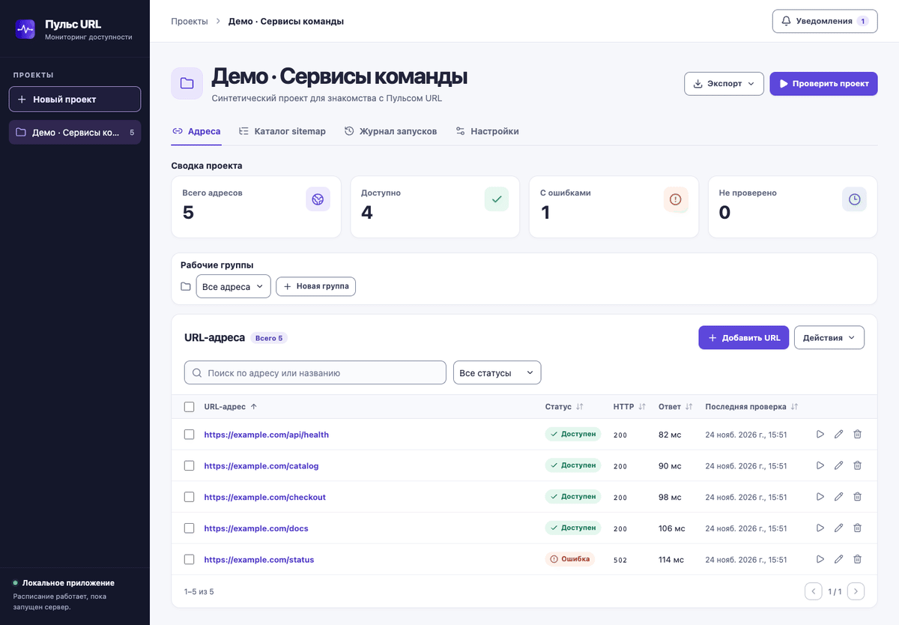

# Пульс URL

Пульс URL проверяет доступность списков HTTP(S)-адресов вручную и по расписанию. В проекте можно собирать адреса из sitemap, объединять их в рабочие группы, сравнивать прогоны и выгружать отчёты. Приложение работает локально в браузере или как настольное приложение Electron. История хранится в SQLite.

## Быстрый запуск

Установите **Node.js 24.x** и выполните команды из папки, где будет храниться проект.

```bash
git clone https://github.com/shanhaichik/URLPulse.git
cd URLPulse
npm ci
npm run build
npm start
```

Откройте ссылку, которую сервер напечатал в терминале. Создайте проект, нажмите **Добавить URL**, вставьте несколько адресов по одному в строке и выберите **Проверить проект**. Результаты появятся в **Журнале запусков**. Для настольного запуска из исходников выполните `npm run desktop` после `npm ci`.

[Сборка установщиков](#сборка-установщиков) · [Адреса и проверки](#адреса-и-проверки) · [Разработка и тесты](#разработка-и-тесты) · [Как внести вклад](CONTRIBUTING.md) · [Заметки к версии](CHANGELOG.md)

## Демонстрация

Проверка проекта, отчёт, сравнение двух прогонов и выгрузка новых сбоев в CSV. В демонстрации используются синтетические адреса и ответы.



[Адреса проекта](docs/media/addresses.png) · [Отчёт по запуску](docs/media/report.png) · [Сравнение и экспорт](docs/media/comparison.png)

## Настольное приложение

- **Windows x64.** Запустите `Pulse-URL-<версия>-win-x64-Setup.exe`, затем откройте **Pulse URL** из меню «Пуск».
- **macOS.** Откройте подходящий DMG для Apple Silicon (**arm64**) или Intel (**x64**) и перетащите **Pulse URL** в папку «Программы».

Установщик включает Electron и среду выполнения. При закрытии окна приложение остаётся в фоне. Открыть окно снова или завершить процесс можно из системного меню **Пульс URL**, в том числе через значок в строке меню или области уведомлений. Для обновления или удаления установленной версии сначала выберите **Выход**.

В Dock и Finder на macOS, на ярлыке и в установщике Windows используется фирменный значок с белым пульсом. Он также виден в боковой панели и на вкладке браузера. В строке меню macOS используется монохромная версия. [Файлы значка и запросы для ImageGen](docs/app-icon.md).

В **Настройках приложения** фоновая работа и SMTP сохраняются независимо. Здесь же доступны **Экспорт базы** и **Восстановить базу**. При восстановлении видны этапы копирования, проверки, подготовки и замены базы. После подтверждения и успешной проверки приложение сохраняет копию прежней базы рядом с ней, заменяет её и перезапускается. Незавершённая проверка с результатами получает статус **Остановлена**, сохраняя плановое число URL и полученные результаты. Расписания после восстановления приостановлены. Их можно включить в тех же настройках. SMTP на другом компьютере настраивается заново.

Если в резервной копии результаты расходятся со счётчиками прогона, восстановление останавливается и сообщает номер прогона. При следующем запуске после аварии приложение проверяет журнал временных файлов копирования и выгрузок и очищает подтверждённые остатки своих операций.

### Сборка установщиков

Версия 1.5.0 публикуется как исходный код. Команды ниже создают локальные установщики без подписи издателя при стандартных настройках. Сборка проверенных подписанных пакетов требует отдельной инфраструктуры.

Для сборочной машины нужен Node.js 24.x. На macOS выполните:

```bash
npm ci
npm run make:mac -- --arch=arm64
npm run make:mac -- --arch=x64
```

На Windows установите [NSIS](https://nsis.sourceforge.io/Download), затем выполните:

```powershell
npm ci
npm run make:windows
```

DMG сохраняются в `out/make/dmg/`, Windows-установщик — в `out/installers/`. Windows-пакет также можно собрать на macOS, если доступен `makensis`. Для нестандартного пути к компилятору задайте `PULSE_MAKENSIS`.

Рядом с итоговым установщиком создаётся `SHA256SUMS.txt`. `PULSE_PACKAGE_OUT` позволяет собрать файлы в отдельную папку.

### Сборка с подписью издателя

Чтобы собрать подписанные установщики, установите `PULSE_PUBLIC_RELEASE=1`. На macOS задайте `PULSE_MAC_SIGN_IDENTITY` и `PULSE_MAC_NOTARY_PROFILE` для настроенного профиля `notarytool`. На Windows настройте SignTool, сертификат издателя в системном хранилище, `PULSE_WINDOWS_CERT_THUMBPRINT` и `PULSE_WINDOWS_TIMESTAMP_URL`. Сборка и проверка подписи выполняются на целевой ОС.

**Desktop checks** и **Tests and coverage** запускаются для pull request, при изменении `main` и вручную. Desktop checks использует GitHub-hosted runners для Windows x64, macOS arm64 и macOS Intel и собирает тестовые артефакты. **Signed desktop release** запускается вручную с защищённой основной ветки. Укажите полный SHA текущего коммита этой ветки. Тег `vX.Y.Z` из версии `package.json` должен указывать на тот же коммит. Архив каждой платформы содержит установщик, `SHA256SUMS.txt` и `release.json` с отпечатком исходников и сведениями о проверках.

Для подписывающего workflow настройте защищённое окружение `desktop-release` с разрешением для основной ветки и обязательным ревью. В нём задайте секреты `PULSE_RELEASE_MAC_SIGN_IDENTITY`, `PULSE_RELEASE_MAC_NOTARY_PROFILE`, `PULSE_RELEASE_WINDOWS_CERT_THUMBPRINT` и `PULSE_RELEASE_WINDOWS_TIMESTAMP_URL`. Ограничьте изменение тегов `v*` и доступ runner group `pulse-signing` доверенным workflow релиза из основной ветки. Нужны выделенные runners macOS arm64, macOS Intel и Windows x64 с установленными инструментами и сертификатами, а также чистые тестовые профили для установки и smoke. Windows-проверку перед публикацией завершите в чистой VM с проверкой Authenticode установщика и установленного приложения, обычной установкой, ссылками из ОС, треем, фоном, файловыми диалогами, восстановлением, повторным запуском и удалением. Формат ссылки на отчёт — `pulse-url://report/?project=N&run=N`.

## Настройка локального сервера

Если пользуетесь nvm, выполните `nvm install` и `nvm use` из папки проекта.

Откройте ссылку с ключом доступа, которую `npm start` напечатал в терминале. Браузер создаст локальную сессию и уберёт ключ из адресной строки. После перезапуска сервера откройте актуальную ссылку заново. Ключ следует хранить как пароль. По умолчанию он создаётся при каждом запуске. При необходимости задайте `PULSE_WEB_ACCESS_KEY` в `.env`, используя случайный ключ из 32–128 символов base64url. Чтобы остановить процесс, нажмите `Ctrl+C`.

Веб-версия рассчитана на одного пользователя и слушает только `127.0.0.1:8731`. API и загрузки требуют действующей сессии браузера. Cookie сессии ограничена хостом и путём `/api`. Браузеры отправляют подходящие cookies на тот же хост независимо от номера порта, поэтому адрес loopback используйте только с доверенными локальными сервисами. Предоставление доступа по сети требует отдельной модели доступа.

База `data/pulse.sqlite3` создаётся автоматически. Путь можно задать через `URL_PULSE_DB` в `.env`. На macOS и Linux база, WAL и SHM используют режим `0600`. Для своего пути укажите отдельный принадлежащий вам каталог с режимом `0700`. Если вы переиспользуете свой старый каталог данных, проверьте его режим и при необходимости задайте `chmod 700 /путь/к/каталогу/данных`. На Windows выбирайте каталог в личном профиле с приватными ACL. То же правило действует для переопределения каталога Electron через `PULSE_DESKTOP_DATA_DIR`.

Веб и Electron по умолчанию используют разные базы. Electron хранит `pulse.sqlite3` в пользовательской папке приложения. С одним файлом SQLite может работать только один экземпляр Пульса URL. Перед запуском другой копии завершите текущую через `Ctrl+C` или меню **Выход**. Рядом с базой хранится служебный файл `*.owner-lock`. Его следует оставлять на месте. Для переноса данных используйте резервную копию SQLite.

## Адреса и проверки

1. Создайте проект и нажмите **Добавить URL**. Можно вставить один адрес, список по одному адресу в строке, загрузить файл sitemap или указать его HTTP(S)-ссылку.
2. Проверьте весь проект, один URL или выделенные в таблице строки. Таблица поддерживает поиск, фильтр по статусу, сортировку по заголовкам и массовое удаление.
3. Нажмите на URL, чтобы открыть его историю, или перейдите в **Журнал запусков** за отчётом. Кнопка со стрелкой скачивания у строки запуска выгружает только его результаты. Доступны CSV, CSV для Excel и JSON.

Обновление страницы восстанавливает открытый проект, вкладку и фильтры отчёта. Кнопки браузера «Назад» и «Вперёд» возвращают предыдущий или следующий экран. После проверки из карточки статус текущей версии и история обновляются в открытой карточке.

Кнопка **Остановить проверку** доступна в панели прогресса, очереди и шапке отчёта активного запуска. Запуск получает статус **Остановлена**, уже полученные результаты остаются в истории и доступны для выгрузки. Повторный ручной запуск того же ожидающего набора использует существующую запись очереди.

В отчёте запуска можно искать по URL или названию и отбирать результаты по полям **Статус** и **HTTP-код**. Когда есть предыдущий завершённый запуск, список **Изменение** позволяет отобрать новые сбои, восстановления и смену HTTP-кода или конечного URL. Выберите нужные значения и нажмите **Найти**. Результат сравнивается с предыдущей по фактическому времени проверкой той же версии адреса из завершённых запусков. «Адреса», сводка и история URL тоже используют время проверки. При равном времени порядок определяется ID результата.

Кнопки экспорта выгружают все завершённые проверки по применённым фильтрам. **CSV для Excel** использует русские заголовки, UTF-8 с BOM и разделитель «;». Выгрузка отдельного прогона включает предыдущие HTTP-код, конечный URL и тип изменения. Выгрузка истории одного URL выдаёт результаты от новых к старым.

В разделе **Настройки → Проект** можно изменить название или описание либо удалить проект. Удаление проекта требует подтверждения и удаляет его адреса, отчёты, расписание и уведомления. Если идёт проверка или отправка письма, дождитесь завершения и повторите удаление.

Чтобы удалить один отчёт, откройте завершённый запуск в **Журнале запусков** и нажмите **Удалить отчёт**. После подтверждения результаты этого запуска и его уведомление удаляются. Статус адреса рассчитывается по последней оставшейся проверке.

За одно добавление списком можно передать до 1 000 адресов. Таблица адресов выдаёт по 25 строк. Для выборок свыше 5 000 строк URL сортируются лексикографически. Изменение URL создаёт новую версию. Подтверждение удаления показывает выбранные адреса, включая скрытые фильтром. Удалённый адрес можно восстановить из его истории или повторным добавлением того же URL. Экспорт проекта включает завершённые проверки всех версий, в том числе удалённых адресов.

Файлы с результатами проверок и URL из каталога получают имя `ГГГГ-ММ-ДД - Название проекта`, например `2026-11-23 - Сервисы команды.csv`. Используется локальная дата выгрузки. CSV для Excel сохраняется с расширением `.csv`.

При поиске или фильтрации над таблицей видно, сколько адресов найдено в текущем списке. Кнопка **Сбросить фильтры** очищает поиск и возвращает все статусы.

Чтобы очистить рабочий список проекта, откройте **Адреса**, выберите **Все адреса** и сбросьте фильтры. В меню **Действия** выберите **Удалить все адреса проекта**. В окне подтверждения будут название проекта, число URL и предупреждение об остановке выполняющихся и ожидающих проверок. Если состав адресов или задач изменится, приложение обновит предпросмотр и попросит подтвердить область повторно. После подтверждения адреса удаляются из рабочего списка одной операцией. Отчёты, расписание, группы и каталог sitemap сохраняются. Перед очисткой дождитесь завершения переноса из каталога или остановите его.

Импорт sitemap читает `urlset` и `sitemapindex`, включая файлы `.xml.gz`, и обходит индексы с вложенными sitemap. Импорт добавляет записи `url/loc`. Итог показывает добавленные адреса, дубликаты, ошибки и превышение лимита проекта. Если вложенный sitemap недоступен или не разбирается, импорт прекращается до сохранения адресов. Ограничения на один импорт — 8 МиБ на документ после распаковки, 32 МиБ суммарно, 100 документов и 50 000 записей.

### Сравнение двух прогонов

В **Журнале запусков** нажмите **Сравнить прогоны** и выберите прогоны для полей **Было** и **Стало**. Из отчёта кнопка **Сравнить с другим прогоном** подставляет открытый прогон справа и предыдущий завершённый слева, если он есть. Завершённый или остановленный прогон доступен для сравнения, если есть хотя бы один результат.

Счётчики над таблицей показывают всю пару. Нажмите на счётчик, чтобы открыть соответствующие строки, или найдите адрес по URL либо названию из любого прогона. В подробностях строки видны HTTP-коды, время ответа и диагностика обеих проверок. Один URL может одновременно учитываться в нескольких счётчиках. Замедления отмечаются, когда два успешных ответа одной версии URL отличаются как минимум на 200 мс и 30%. Смену версии адреса, разный состав прогонов и непроверенные URL таблица показывает отдельными категориями.

Сравнение сохраняет пару и фильтры при обновлении страницы. Выгрузка в CSV, CSV для Excel или JSON включает все строки по применённым фильтрам и данные обоих прогонов.

### Рабочие группы

Откройте **Адреса** и нажмите **Новая группа**. В общем списке отметьте нужные URL и выберите **Добавить в группу**. При выборе группы выделение остаётся, и адреса можно добавить прямо в открытую группу. Один адрес может входить в несколько групп. Выберите группу в выпадающем списке, чтобы искать, сортировать и отбирать её адреса. Кнопка **Убрать из группы** исключает выделенные URL из выбранной группы. Рядом с выбором группы доступны переименование и удаление. Адреса и отчёты удалённой группы остаются в проекте.

**Проверить всю группу** запускает проверку всех её активных URL, включая скрытые текущим фильтром. Состав фиксируется при запуске и сохраняется при последующих правках группы. **Экспорт группы** выгружает результаты запусков этой группы и их перезапусков. Для экспорта одного прогона откройте **Прогоны группы** или общий **Журнал запусков** и нажмите кнопку со стрелкой скачивания в нужной строке. Открытый отчёт также поддерживает выгрузку с применёнными фильтрами.

### Каталог больших sitemap

Откройте проект → **Каталог sitemap**, затем укажите HTTP(S)-ссылку или выберите XML/XML.GZ. Поддерживаются вложенные индексы, до 1 000 документов, до 256 МиБ на документ, до 2 ГиБ распакованных данных за импорт и до 1 000 000 уникальных URL на проект. Импорт продолжается в фоновом потоке при закрытой вкладке или окне, пока запущен сервер или Electron. Импорт можно поставить на паузу, продолжить или отменить. При возобновлении незаконченный документ читается заново, а завершённые документы сохраняются.

После успешного обновления откройте фильтр **Изменения**, чтобы увидеть новые и исчезнувшие URL или изменения `lastmod`. Проект хранит текущую и предыдущую версии каждого источника. Резервная копия сохраняет опубликованные версии. Введите домен или префикс пути и нажмите **Найти**. Таблица показывает применённую область и загружает по 100 строк. **Повторить** восстанавливает запрос с теми же параметрами после ошибки, а **Сбросить фильтры** открывает первую страницу с исходным порядком.

Выберите URL вручную или задайте число первых адресов по применённому фильтру, до 5 000 за операцию. **Проверить** ставит выбранные URL в очередь и создаёт отчёт в журнале. С помощью **В рабочий список** добавьте адреса для проверок проекта по расписанию. CSV можно выгрузить для выбранных адресов или для всего результата фильтра. Пока фильтр редактируется или данные загружаются, действия по выборке ждут актуальную выдачу. В Electron файлы выбираются и сохраняются через системные диалоги.

Чтобы перенести весь каталог, нажмите **Добавить все в «Адреса»** и подтвердите область переноса. Участвуют опубликованные версии всех источников проекта. Ход и итог отображаются в каталоге. Кнопка **Остановить перенос** сохраняет уже добавленные адреса и освобождает проект для проверок. Перенос в работе продолжается после перезапуска приложения с последней сохранённой позиции. В **Истории импортов** доступны старые задания и их статусы. Удаление источника сохраняет уже перенесённые адреса в рабочем списке.

Чтобы начать с пустого каталога, сбросьте фильтры URL и нажмите **Очистить каталог**. Подтверждение показывает проект, число источников, записей импорта и URL в опубликованных версиях. При обновлении источника или изменении задач после предпросмотра приложение запросит подтверждение заново. Очистка останавливает импорты и перенос в «Адреса», затем удаляет все источники проекта, сохранённые версии и историю каталога. Чтение страницы, начатое до удаления, может показать сохранённую версию целиком. Следующее чтение обновит список или сообщит, что источник удалён. Уже перенесённые адреса и отчёты сохраняются. Запущенные и ожидающие проверки URL продолжаются по сохранённым спискам.

Проверка выполняет GET с общим тайм-аутом 10 секунд и максимум пятью перенаправлениями. Итоговый HTTP 2xx считается доступным. В отчёт попадают HTTP-код, время до получения заголовков, конечный URL, число перенаправлений, `Content-Type`, `Content-Length` и причина сбоя. Приватные и зарезервированные IP отклоняются. Тела ответов проверяемых URL не сохраняются. Каталог sitemap читает XML и GZIP потоково.

В **Настройках проекта → Проверки** задайте число **одновременных проверок** от 1 до 24. По умолчанию используется 6. Чтобы вернуть это значение, нажмите **Сбросить до 6**, затем **Сохранить настройки**. Лимит считывается при начале каждого запуска, включая запуски по расписанию и те, что уже стоят в очереди.

В карточке URL есть кнопка **Открыть в браузере**. Она открывает сохранённый адрес в обычном браузере. Если HTTP 401 сопровождается признаком проверки Curator, отчёт показывает эту диагностику вместе с результатом TLS.

### Российский корневой CA

Профиль **Штатные сертификаты + Российский CA** добавляет доверие к корневому сертификату Минцифры для HTTPS-проверок и удалённых sitemap выбранного проекта. Штатный профиль готов к работе сразу. Файл для дополнительного профиля скачивается отдельно.

1. Скачайте **Russian Trusted Root CA** с портала [Госуслуги](https://www.gosuslugi.ru/crt). Подходят PEM и DER. Сохраните файл под именем `Russian_Trusted_Root_CA.cer`.
2. Создайте папку `cert`, если её ещё нет, и поместите в неё файл. Путь зависит от способа запуска.

   | Режим | Папка `cert` |
   | --- | --- |
   | Локальная веб-версия | `cert/` в каталоге исходников |
   | Electron на macOS | `~/Library/Application Support/Pulse URL/cert/` |
   | Electron на Windows | `%APPDATA%\Pulse URL\cert\` |

3. Полностью перезапустите приложение. В Electron сначала выберите **Выход**. В **Настройках проекта → HTTPS** выберите **Штатные сертификаты + Российский CA** и сохраните настройки.

Свой путь можно задать через `PULSE_RUSSIAN_CA_FILE`. Для `npm start` укажите абсолютный путь в `.env`. Для Electron задайте переменную в окружении запуска либо поместите файл в `cert/` внутри `PULSE_DESKTOP_DATA_DIR`, если такой каталог уже выбран.

Пульс URL проверяет SHA-256, назначение, самоподпись и срок действия сертификата. Ошибка `ERR_TLS_PROFILE_CA` в отчёте и выгрузках означает, что файл отсутствует или не прошёл проверку. Профиль применяется внутри приложения без установки CA в системное хранилище.

## Заголовки, авторизация и прокси

1. Откройте **Настройки** проекта и найдите раздел **HTTP-запросы**. Добавьте профиль с названием и адресом сервера, например `https://api.example.org:8443`. Профиль действует на все пути с этой схемой, хостом и портом.
2. Добавьте заголовки, например `User-Agent` или `Accept`, и выберите авторизацию сайта. Доступны Basic, Bearer и API-ключ в отдельном заголовке. Пометьте как **Секрет** любой пользовательский заголовок с ключом или токеном. Для авторизации и секретных заголовков требуется HTTPS.
3. Если нужен прокси, укажите его адрес в разделе маршрута. HTTPS-адреса проверяются через CONNECT к HTTP- или HTTPS-прокси. Если прокси требует Basic-авторизацию, укажите его логин и пароль отдельно и используйте HTTPS-адрес прокси.
4. Включите профиль по умолчанию для указанного сервера или назначьте его в окне редактирования отдельного URL. Для URL доступен также режим **Без профиля**. Сохраните профиль и запустите **Проверить профиль** на одном адресе.

Профили применяются к ручным, групповым и плановым проверкам. При постановке в очередь сохраняются выбранные настройки. Перезапуск остановленной проверки использует прежний список URL с текущими настройками профилей. После удаления профиля или смены его сервера ранее назначенные ему адреса переходят в режим **Без профиля**. Для импорта sitemap действуют настройки HTTPS проекта.

При переходе на другой сервер запрос отправляется со стандартными заголовками. Если в HTTP-профиле задан конкретный прокси, приложение продолжает использовать его. Отчёт и выгрузки показывают имя профиля, маршрут и этап сбоя. Код `407` от прокси отображается отдельно от HTTP-кода сайта, например `401` или `403`.

В настольном приложении значения секретов хранятся зашифрованными средствами ОС. Пустое поле сохраняет прежнее значение. При смене сервера, имени секретного заголовка или логина введите секрет заново. Чтобы удалить секрет из профиля, удалите секретный заголовок, отключите авторизацию сайта или отключите авторизацию прокси. При переносе резервной копии на другой компьютер введите секреты заново.

Для локального веб-приложения задайте переменные `PULSE_REQUEST_SECRET_…` в `.env` и перезапустите сервер. В поле секрета укажите имя переменной, например `PULSE_REQUEST_SECRET_API_TOKEN`. Несуществующая или пустая переменная приводит к ошибке настройки профиля. Секреты из `.env` заменяются и удаляются в самом файле.

### PAC-файл проекта

В разделе **Настройки проекта → HTTP-запросы** загрузите локальный файл `.pac` в UTF-8 размером до 256 КиБ. Нажмите **Проверить маршрут** и введите URL, чтобы увидеть источник и порядок маршрутов. Работает в настольном приложении и в локальной версии `npm start`.

PAC поддерживает прямой маршрут `DIRECT` и публичные прокси `PROXY` и `HTTPS` для проверки HTTPS-адресов. При сбое подключения приложение может попробовать следующий маршрут, указанный в PAC. Для HTTP-адреса работает прямой маршрут. Ошибки TLS и ответ прокси `407` останавливают проверку. Прокси с Basic-авторизацией настраивается в HTTP-профиле.

Проверка маршрута покажет ошибку, если файл вернёт неподдерживаемую директиву, например `SOCKS5`. Функция PAC `dnsResolve()` выполняет IPv4 DNS-запросы по полному имени. Правила, зависящие от файла `hosts`, поисковых суффиксов или особых настроек DNS в браузере, могут выбрать другой маршрут.

Ручной прокси HTTP-профиля имеет приоритет. Профили с заголовками и авторизацией сайта могут использовать PAC проекта. Режим URL **Без профиля** задаёт прямое подключение. При редиректе PAC заново выбирает маршрут, а отчёт и выгрузки показывают использованный маршрут, адрес прокси и источник настройки.

Один проект использует один активный PAC-файл. Его можно заменить или отключить. Ручные и плановые прогоны сохраняют выбранную версию при постановке в очередь. PAC-файл и версии, на которые ссылаются прогоны, входят в резервную копию базы.


## Расписание и уведомления

В **Настройках** проекта включите расписание, выберите дни недели, время и часовой пояс. По умолчанию используется `Europe/Moscow`. Следующий запуск отображается при включённых расписаниях. Изменение расписания пересчитывает следующее время. Сохранение остальных настроек сохраняет уже назначенный слот. Во время глобальной паузы проверка в работе завершается, ручные запуски доступны, а ожидающие проверки по расписанию остаются в очереди до возобновления. Пропущенные за время простоя запуски объединяются в один при следующем старте сервера. Вкладку можно закрыть, пока сервер работает.

В настройках проекта выберите, когда присылать уведомления — о каждом завершённом запуске, только при ошибках или никогда. Лента доступна через кнопку **Уведомления**. Открытие отчёта отмечает его уведомление прочитанным. При закрытии отчёта лента возвращается к прежней странице. Действие **Отметить все как прочитанные** доступно на любой странице, пока есть непрочитанные. Кнопка **Очистить уведомления** убирает текущие записи из ленты после подтверждения.

Чтобы подключить email:

1. Выполните `cp .env.example .env` в папке проекта.
2. Укажите `SMTP_HOST`, `SMTP_PORT`, `SMTP_TLS_MODE`, `SMTP_USER`, `SMTP_PASSWORD` и `SMTP_FROM`. Для STARTTLS обычно используется порт 587 и режим `starttls`. Для TLS с начала соединения обычно используется порт 465 и режим `tls`.
3. Перезапустите сервер и укажите email получателя в настройках проекта.

Временные сбои отправки повторяются через 1, 2 и 4 минуты. При повторе сохраняется идентификатор письма. Отчёт доступен сразу, а состояние доставки и число начатых попыток видны в ленте. Если приложение завершилось во время отправки, после запуска в ленте появится статус **Доставка не подтверждена**. Проверьте почтовый ящик получателя. Для писем с этим статусом автоматические повторы отключены.

Ссылка из письма открывает отчёт на компьютере, где запущен Пульс URL. В веб-версии потребуется действующая браузерная сессия. Для резервной копии можно остановить приложение и скопировать файл базы.

При экспорте и восстановлении из Electron приложение учитывает реальный путь родительской папки, в том числе при выборе через ссылку. Для копии выберите отдельный файл. Приложение отклонит путь к активной базе или её служебным файлам SQLite.

## Разработка и тесты

```bash
npm run dev
npm run typecheck
npm test
npx playwright install chromium
npm run test:e2e
npm run test:desktop
```

В режиме разработки интерфейс доступен на порту 5173, API использует порт 8731. Откройте стартовую ссылку из вывода `npm run dev`. Playwright запускает собственный сервер на порту 8732. Тесты работают с временной SQLite и контролируемыми ответами HTTP и SMTP.

`npm run desktop` запускает настольную сборку из исходников. Desktop smoke-тест проверяет IPC, фоновый запуск, CSV и восстановление на временной базе. Переменная `PULSE_SMOKE_EXECUTABLE` позволяет прогнать тот же сценарий на готовом приложении. После сборки `node e2e/desktop-settings-smoke.mjs` отдельно проверяет сохранение настроек, результат копирования и переход по ссылке. Для своих тестовых профилей в Windows можно задать `PULSE_DESKTOP_SKIP_PROTOCOL_REGISTRATION=1`, чтобы Electron пропустил регистрацию схемы в ОС.

После сборки `node e2e/export-snapshot.mjs` и `node e2e/desktop-export-snapshot.mjs` проверяют все три формата при удалении отчёта во время выгрузки. `node e2e/catalog-export-lifecycle.mjs` проверяет освобождение SQLite при обрыве скачивания и завершении сервера во время выгрузки всего каталога или выбранных URL.

Команда `node e2e/desktop-comparison-export.mjs` после сборки сверяет выгрузки сравнения в HTTP и Electron при одновременном удалении одного из прогонов.

После сборки `node e2e/local-web-session-smoke.mjs` проверяет вход, перезагрузку и экспорт в браузере. `node e2e/desktop-permissions-smoke.mjs` проверяет отказ в разрешениях Chromium и доступность штатного диалога сохранения Electron. `node e2e/desktop-recovery-audit.mjs` проверяет очистку временных файлов на старте и отказ при логически неверной резервной копии.

### Покрытие тестами

```bash
npm run test:coverage
npm run test:coverage:browser
```

Vitest сохраняет сводку и HTML-отчёт в `coverage/node/`. Браузерный прогон сохраняет покрытие React в `coverage/browser/`. Он собирает инструментированное приложение во временную папку и использует отдельную SQLite. Для запуска через установленный Chrome можно задать `PULSE_E2E_BROWSER_CHANNEL=chrome`. В GitHub Actions результаты обоих прогонов доступны в артефакте **coverage**.

Пороги полного прогона составляют 80% строк и 75% ветвей для Vitest, 84% строк и 79% ветвей для React. Для проверки отдельных файлов используйте `npm test -- tests/имя.test.ts` или `npx playwright test e2e/имя.spec.ts` после сборки.

Границы измерения, пробелы и сценарии описаны в [аудите покрытия](docs/audits/2026-11-23/TEST_COVERAGE.md).

## Производительность интерфейса

[Аудит 1.2.0](docs/performance-audit-1.2.0.md) описывает тестовый набор, замеры в Electron и Chromium и проверку клавиатуры и мобильной вёрстки. Для повтора установите Chromium для Playwright и выполните `npm run audit:performance`. Переменная `PULSE_BENCHMARK_DESKTOP` переключает тот же сценарий на собранное desktop-приложение.

Нагрузочный сценарий каталога запускается командой `npm run audit:catalog`. Он проверяет две формы импорта 500 001 URL, сравнение снимка на 1 млн URL и задержку выдачи страницы из 100 строк в Electron во время обновления.

После сборки `node scripts/desktop-restore-audit.mjs` замеряет этапы восстановления, память основного процесса и отклик Electron на временной копии с миллионом строк каталога и 240 000 результатов.

Массовый перенос и постановку проверок можно замерить командой `npm run audit:worklist`. Сценарий использует временную базу с 1 млн синтетических URL. Он проверяет отзывчивость таблицы во время переноса и размер порции проверок без сетевых запросов к адресам из каталога.

После сборки `node scripts/worklist-history-audit.mjs` измеряет запросы на 20 000 URL и 240 000 результатов. Вывод содержит p50/p95, порядок строк, планы SQLite и число повторных запросов при изменении другого проекта.

Команда `node scripts/run-comparison-audit.mjs` после сборки измеряет сводку, фильтры, переход между страницами и потоковую выгрузку на двух прогонах по 100 000 URL. Она запускает браузер и сервер с временной базой.

## Лицензия

Исходный код Пульса URL распространяется по лицензии [MIT](LICENSE).
