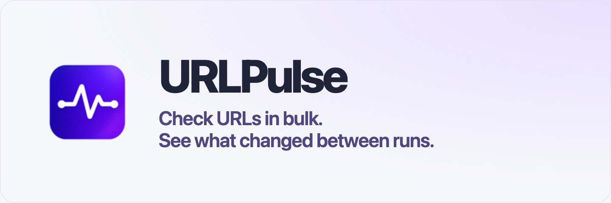
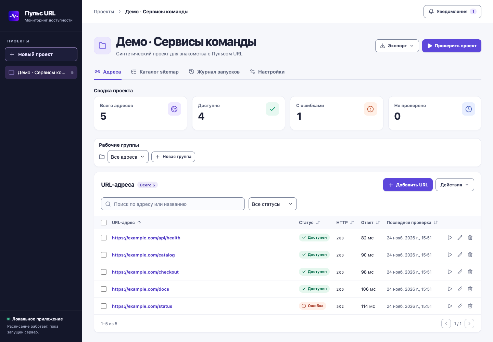

# URLPulse

**English** · [Русский](README.ru.md)

<picture>
  <source media="(prefers-color-scheme: dark)" srcset="docs/media/branding/hero-dark.png">
  
</picture>

URLPulse is a local tool for checking lists of HTTP and HTTPS addresses. It gives site owners, QA teams, and SEO specialists a history of outages, recoveries, and changes they can compare and export.

[](LICENSE) [](package.json)

[Quick start](#quick-start) · [User guide](docs/user/README.en.md) · [Developer guide](docs/development/README.md) · [Contributing](CONTRIBUTING.md)

## Quick start

Install **Node.js 24.x**, then run these commands in the folder where you want to keep the project.

```sh
git clone https://github.com/shanhaichik/URLPulse.git
cd URLPulse
npm ci
npm run build
npm start
```

Open the private access link printed in the terminal. The interface is in Russian. Choose **Новый проект** (New project), **Добавить URL** (Add URLs), and paste addresses one per line. Click **Проверить проект** (Check project) and open the results in **Журнал запусков** (Run history). Keep the process running for scheduled checks.

The current GitHub release contains source archives. Use `npm run desktop` to launch Electron from source after `npm ci`. The [desktop build guide](docs/development/README.md) covers macOS Apple Silicon, macOS Intel, and Windows x64 installers.

## See it in action



[12-second demo](docs/media/workflow.gif) · [Run report](docs/media/report.png) · [Run comparison and filtered export](docs/media/comparison.png)

The demo runs a check on five synthetic addresses, opens the report, compares two runs, and saves a CSV containing the new failures.

## What you can do

| Task | How URLPulse helps |
| --- | --- |
| Build a working list | Paste URLs, import a sitemap, or group addresses by service or area. The sitemap catalog supports up to 1 million unique URLs per project. |
| Repeat a check | Run a project, work group, or selection on demand. Schedule recurring checks and stop an active run while preserving its results. |
| See what changed | Compare two runs to find new failures, recoveries, changed codes or redirects, and slower responses. |
| Share findings | Filter results and export a URL history, a run, a project, or a comparison as CSV, CSV for Excel, or JSON. |
| Set up a project | Configure HTTPS trust, request headers, authentication, a proxy or PAC file, and in-app or SMTP notifications. |

## Documentation

- [User guide](docs/user/README.en.md) covers checks, sitemap imports, comparison, notifications, data, and backup.
- [Developer guide](docs/development/README.md) covers setup, testing, and packaging. The [architecture reference](docs/development/architecture.md) explains the data model and the HTTP and Electron IPC boundaries.
- [Documentation index](docs/README.md) links to both languages, release notes, and audit material.

For development, run `npm run dev`. Run `npm run typecheck` and `npm test` to check your changes.

The interface uses React and TypeScript. A Fastify service and SQLite store handle the shared logic for the web and Electron modes. The web server listens on `127.0.0.1` and requires a local browser session. Network requests go to the URLs you check and any proxy or SMTP server you configure. The optional Russian CA is downloaded separately and verified against a pinned certificate fingerprint. See the [user guide](docs/user/README.en.md) and [security policy](SECURITY.md).

## Contributing

Report bugs and propose changes through GitHub Issues. Check the [contributing guide](CONTRIBUTING.md) for local setup and pull request expectations. The source is available under the [MIT License](LICENSE).
