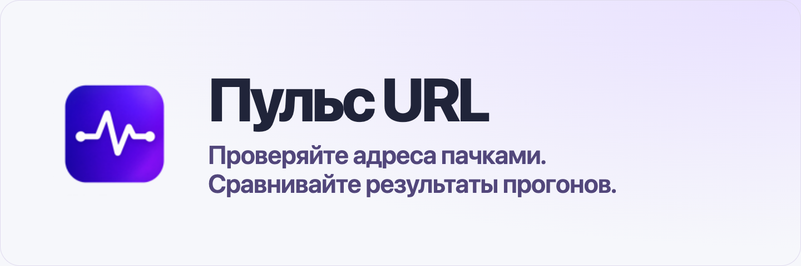
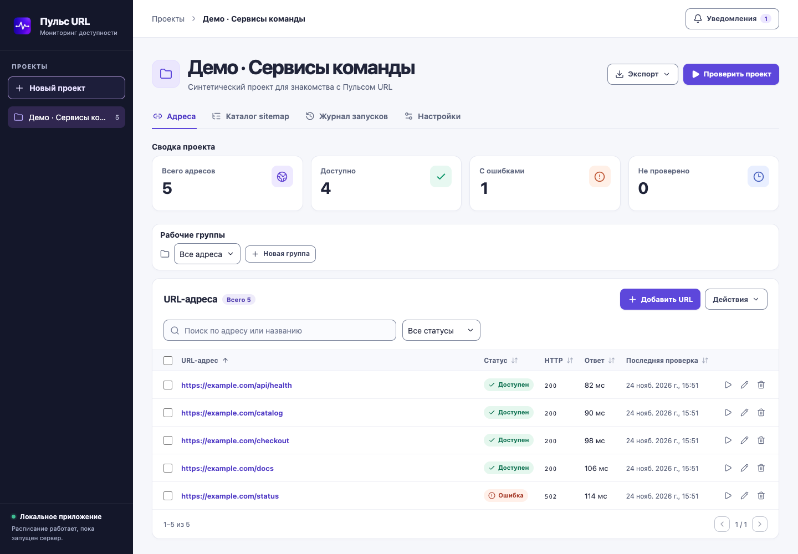

# Пульс URL

[English](README.md) · **Русский**

<picture>
  <source media="(prefers-color-scheme: dark)" srcset="docs/media/branding/hero-ru-dark.png">
  
</picture>

Пульс URL локально проверяет списки HTTP- и HTTPS-адресов. Он помогает владельцам сайтов, QA- и SEO-специалистам увидеть, где появились ошибки, что восстановилось и какие ответы изменились между прогонами.

[](LICENSE) [](package.json)

[Быстрый запуск](#быстрый-запуск) · [Руководство пользователя](docs/user/README.md) · [Руководство разработчика](docs/development/README.md) · [Как внести вклад](CONTRIBUTING.md)

## Быстрый запуск

Установите **Node.js 24.x** и выполните команды из папки, в которой хотите хранить проект.

```sh
git clone https://github.com/shanhaichik/URLPulse.git
cd URLPulse
npm ci
npm run build
npm start
```

Откройте приватную ссылку, которую сервер напечатал в терминале. Выберите **Новый проект** и **Добавить URL**, вставьте адреса по одному в строке и нажмите **Проверить проект**. Результаты появятся в **Журнале запусков**. Чтобы работало расписание, оставьте процесс запущенным.

Текущий релиз на GitHub содержит архивы исходного кода. Для запуска Electron после `npm ci` выполните `npm run desktop`. Сборка установщиков для macOS Apple Silicon, macOS Intel и Windows x64 описана в [руководстве разработчика](docs/development/README.md).

## Демонстрация



[Демо на 12 секунд](docs/media/workflow.gif) · [Отчёт по прогону](docs/media/report.png) · [Сравнение прогонов и экспорт](docs/media/comparison.png)

В демо проверяем пять синтетических адресов, открываем отчёт, сравниваем прогоны и сохраняем CSV с новыми сбоями.

## Что можно делать

| Задача | Как помогает Пульс URL |
| --- | --- |
| Собрать рабочий список | Вставьте URL, импортируйте sitemap или объедините адреса по сервисам и разделам. В каталоге sitemap можно хранить до 1 млн уникальных URL на проект. |
| Повторить проверку | Запускайте проект, рабочую группу или выборку вручную. Для проекта можно задать расписание. При остановке прогона полученные результаты сохраняются. |
| Найти изменения | Сравнивайте два прогона и находите новые сбои, восстановления, изменения кодов и конечных адресов, а также замедления. |
| Передать результаты | Фильтруйте результаты и выгружайте историю URL, прогон, проект или сравнение в CSV, CSV для Excel или JSON. |
| Настроить проект | Задавайте профиль HTTPS, заголовки, авторизацию, прокси или PAC и выбирайте режим уведомлений в ленте и по SMTP. |

## Документация

- [Руководство пользователя](docs/user/README.md) описывает проверки, импорт sitemap, сравнение, уведомления и работу с данными.
- [Руководство разработчика](docs/development/README.md) содержит команды запуска, тестирования и сборки. [Архитектура](docs/development/architecture.md) объясняет модель данных и границы HTTP API и Electron IPC.
- [Оглавление документации](docs/README.md) ведёт к руководствам на двух языках, заметкам к версии и материалам аудита.

Для разработки используйте `npm run dev`, для проверки изменений — `npm run typecheck` и `npm test`.

Интерфейс написан на React и TypeScript. Веб- и настольная версии используют общую логику Fastify и SQLite. Веб-сервер слушает `127.0.0.1` и требует локальную сессию браузера. Приложение обращается к проверяемым URL и к настроенным прокси или SMTP-серверу. Российский CA скачивается отдельно, приложение сверяет его отпечаток. [Работа с данными](docs/user/README.md) · [Политика безопасности](SECURITY.md)

## Как внести вклад

Сообщайте об ошибках и предлагайте улучшения через GitHub Issues. Команды и требования к pull request описаны в [правилах контрибьютинга](CONTRIBUTING.md). Исходники распространяются по [лицензии MIT](LICENSE).
