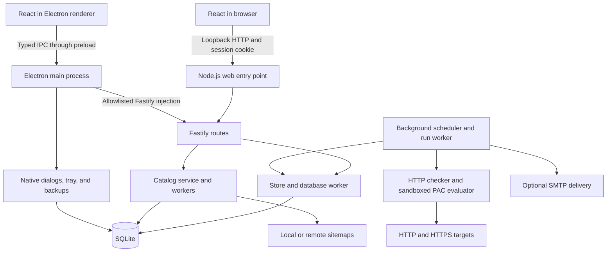
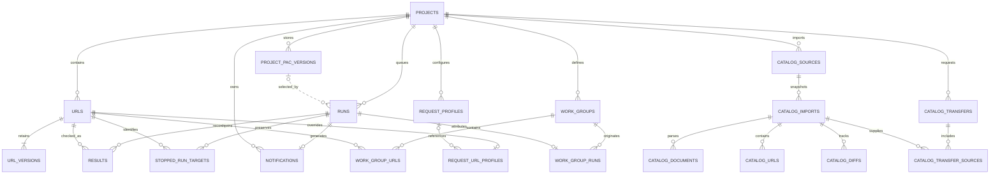

# Architecture and contracts

[Русский](architecture.ru.md) · [Developer guide](README.md)

URLPulse is a local, single-user application. The React renderer uses one API client in both modes. Browser requests go over loopback HTTP. Electron serves the UI at `pulse-app://app/` and sends allowed requests through a sandboxed preload bridge to Fastify’s in-process `inject()` interface.



`main.ts` in each runtime prepares the profile, claims the database, and starts the catalog and background services. The web host listens on loopback and stops on SIGINT or SIGTERM. The desktop host owns the window, tray, report links, and file access. Closing its window hides it, allowing background work to continue. **Quit** drains work and closes the database. [Web entry point](../../src/server/main.ts) · [Desktop entry point](../../src/desktop/main.ts)

React stores current UI state in hooks, keeps navigation and applied filters in the URL, and refreshes progress through polling. Project summary requests can send the last `revision` as `since` and receive `{ unchanged: true }`. Durable state lives in SQLite. The API validates inputs before handing work to the store or catalog. Long database operations use a worker and streaming exports use read snapshots so concurrent changes do not alter an in-flight export. [`src/client/api.ts`](../../src/client/api.ts) · [`src/server/app.ts`](../../src/server/app.ts) · [`database-tasks.ts`](../../src/server/database-tasks.ts)

The run worker claims queued checks, resolves their saved request policy, runs checks in bounded batches, and persists results and counters. Check failures become per-URL results with diagnostic fields. Finishing a run can enqueue a notification and email. On ordinary restart, interrupted running checks are requeued and interrupted email sends are recorded as uncertain. [`worker.ts`](../../src/server/worker.ts) · [`store.ts`](../../src/server/store.ts)

## Language settings

The browser and Electron bundle `ru-RU` and `en-US` catalogs. The renderer updates copy and formatting through a root language subscription, preserving navigation and task state. The web app stores `urlpulse.locale` in browser storage and synchronizes tabs on the same origin. Electron stores the language in its profile preferences and updates the menu, tray, and app-provided dialog captions.

SQLite keeps original diagnostics and stable machine fields. The UI translates recognized diagnostics at render time, including relevant historical results. A report export captures the requested locale once. The email worker reads the language for the whole installation from `PULSE_EMAIL_LOCALE` on web or from Electron's `emailLocale` preference independently of the current window. [Translation guide](../localization/TRANSLATION_GUIDE.en.md) · [Catalog source](../../src/shared/i18n/)

## Repository layout

```text
src/
  client/          React screens, navigation, API client, and styles
  server/          Fastify routes, SQLite store, checker, scheduler, and workers
    catalog/       Sitemap imports, catalog queries, export, and transfers
  desktop/         Electron main and preload, preferences, secrets, and backup
  shared/          TypeScript contracts shared across runtimes
tests/             Vitest tests and fixtures
e2e/               Playwright specs, fixture server, and standalone smoke scripts
scripts/           Coverage tooling and performance scenarios
packaging/         DMG and NSIS packaging, signing, and installer smoke scripts
desktop-assets/    Desktop icon assets
public/            Static assets served with the UI
.github/workflows/ Test, desktop check, and signed packaging workflows
docs/              User and developer documentation
```

## SQLite data model

The diagram shows the relationships used to interpret worklists, reports, and catalog snapshots. Join tables carry membership, run provenance, or transfer inputs. See the schema files for complete columns, indexes, migrations, and constraints. [Core schema](../../src/server/schema.ts) · [Catalog schema](../../src/server/catalog/schema.ts) · [Store migrations](../../src/server/store.ts)



- Active URLs are unique within a project. URL edits create versions and removal archives the URL, preserving history. Results store the checked version, URL, and label alongside the result. The latest result is determined by check time and then result ID. Report change flags compare to the preceding checked result of the same version from a finished `done` run.
- A run is `queued`, `running`, `done`, or `cancelled`. There is at most one result for a URL in a run. Planned totals, checked totals, and outcomes are tracked separately. Stopping a run preserves its checked results and saves remaining targets separately when applicable. Enqueuing a run saves its TLS profile, request configuration, and PAC revision. A PAC revision identifies the script and the project's normalized proxy rules, including credential references. At most one revision is active per project. Enqueuing a catalog import captures the same revision in `catalog_imports.pac_revision` so resume and recovery use the queued configuration.
- The PAC tunnel selects a rule by scheme, hostname, and port and pins the proxy socket to the validated DNS result. Trusted rules may allow RFC 1918 or IPv6 ULA proxy addresses and delegate target DNS selection to the proxy. Basic is scoped to the matching HTTPS proxy. The catalog worker requests only credential references in its snapshot through its parent, and the parent releases an unused Electron secret when its last active or resumable task and setting are gone.
- Catalog sources track current and previous import snapshots. Each snapshot has its documents, URL rows, and diffs. An import has one row per distinct URL. Transfers reference their input imports and can populate the worklist incrementally. Catalog actions can check URLs before adding them to the worklist.
- SQLite uses WAL and foreign keys. The separate `.owner-lock` file prevents two app instances from opening the same profile database while allowing a restore to replace the database file. Web request secrets are resolved from environment variables. Electron encrypts request secrets and SMTP credentials using OS-backed storage outside the SQLite database.

Electron exports SQLite with the backup API. Restore stages a copy, validates its schema and foreign keys, applies migrations, and verifies run counters and targets. It preserves results from partially completed runs, disables pending mail, and removes incomplete catalog work from the restored copy. After confirmation and validation, it shuts down database activity, saves a copy of the old database, pauses schedules, replaces the database, and relaunches. The staging journal lets the next startup clean up temporary files left by interrupted file operations. Configure SMTP and request secrets separately on the destination machine. For a manual web backup, stop the web process cleanly before copying the database file. [Ownership](../../src/server/database-owner.ts) · [Backup and restore](../../src/desktop/backup.ts) · [Staging journal](../../src/desktop/staging.ts)

## Loopback HTTP API

These are the application’s internal UI contracts. The web server binds to `127.0.0.1:8731`. Open the emitted `/#access=…` link to start a browser session. The client removes the fragment and sends `POST /api/session` with `{ "key": "…" }`. Success is `204` with a host-only `pulse_web_session` cookie scoped to `/api` and marked `HttpOnly`, `SameSite=Strict`, and `Secure`. API calls need that cookie and writes need the local application origin. [Session implementation](../../src/server/web-access.ts) · [Routes](../../src/server/app.ts)

| Method and path | Contract |
| --- | --- |
| `GET /api/projects` | Returns `{ projects, unread, smtpConfigured }` and `schedulesPaused` when available. |
| `POST /api/projects` | JSON `{ name, description? }`, with a 70-character name and an optional description up to 200 characters. Returns the project with `201`. |
| `GET /api/projects/:projectId?view=summary` | Returns the project summary and revision token. Pass `since` for conditional polling. |
| `GET /api/projects/:projectId/urls/page` | Optional `page`, `q`, `status`, `sort`, `direction`, and `group`. Returns `{ items, total, page }`. |
| `POST /api/projects/:projectId/urls` | JSON `{ input, label? }`. Pass up to 1,000 nonblank lines. `label` is used for a single address. Returns `201` with `{ added, duplicates, invalid, skipped, issues }`. |
| `GET /api/projects/:projectId/urls/:urlId` | Returns `{ address, versions, history }`. Older results use `before` and optionally `beforeAt`. |
| `POST /api/projects/:projectId/runs` | Send `{}` for the worklist or `{ ids: [...] }` for up to 5,000 selected URL IDs. Returns `202` with `{ id }`. |
| `GET /api/projects/:projectId/runs?view=page` | Run history with `{ items, nextBefore }`. Pass `before` for the next page. `view=queue` returns the queue. |
| `GET /api/projects/:projectId/runs/:runId` | Report with `{ run, results, previousRun, nextAfter, restart }`. Accepts `after` and the filters `q`, `status`, `httpCode`, and `change`. |
| `POST /api/projects/:projectId/runs/:runId/stop` and `POST …/runs/:runId/restart` | Stop the run and return its resulting state, or enqueue a new run from a stopped run and return `202` with `{ id }`. |
| `GET /api/projects/:projectId/run-comparison` | Requires distinct `baseline` and `target` run IDs in the project with completed checks in a `done` or `cancelled` run. Use `view=summary` for counts or omit `view` for `{ items, nextAfter }`. Optional `q`, `kind`, and `after` filter or page the results. |
| `GET /api/projects/:projectId/export`, `GET …/runs/:runId/export`, `GET …/urls/:urlId/export`, `GET …/groups/:groupId/export`, `GET …/run-comparison/export` | Stream downloads with `format=csv`, `excel`, or `json`. For Excel, `locale=en-US` selects English and `ru-RU` is the default. CSV and JSON retain machine fields. Project, run, URL, and group exports use applicable report filters. Comparison export takes the comparison run IDs and filters. |
| `GET /api/projects/:projectId/catalog`, `GET …/catalog/page`, `POST …/catalog/imports` | Read source and job summaries, page catalog rows, or enqueue an import. File imports send bytes with `PUT …/catalog/imports/:jobId/file` and `Content-Type: application/octet-stream`. [Catalog routes](../../src/server/catalog/routes.ts) |
| `GET /api/projects/:projectId/request-profiles` | Returns `{ profiles, secretMode }`. Read an address override with `GET …/urls/:urlId/request-profile`. Set it with `PATCH` to the same path and JSON `{ profileId }`, where the value is `'inherit'`, `null` for direct routing, or a saved profile ID. |
| `GET`, `PUT`, `PATCH`, or `DELETE /api/projects/:projectId/proxy-pac` and `POST …/proxy-pac/test` | Read, upload, update proxy rules, or clear the active PAC. `PUT` takes `{ filename, source }` with source up to 256 KiB. `PATCH` takes `{ revision, proxies }`, where each rule includes `url`, `allowPrivate`, `connectByHostname` and optionally `auth: { username, secret? }`. An outdated revision returns 409. Omitting a password retains it for the same proxy and username. The response `{ pac }` provides metadata, credential status, or `null`. The preview takes `{ url }` and returns `{ routes, source }`. |

Application errors keep the JSON `{ error: string }` field. Requests with `x-urlpulse-i18n: 1` retain the original error text and can also receive a `messageKey` and validated `messageParams`. Direct Excel downloads with `locale=en-US` receive known errors in English. Typical statuses are `400` for invalid input, `401` for invalid or missing session credentials, `403` for a disallowed host or origin, `404` for a missing record, `409` for a state conflict, `413` for a size limit, and `503` for a busy database. Check failures are stored with `status: "error"` in the corresponding URL result. Paths abbreviated with `…` share the project prefix.

Run this read-only example in the browser console after opening a valid session. It prints the first project’s first report page when run history exists.

```js
const read = async path => {
  const response = await fetch(path);
  const data = await response.json();
  if (!response.ok) throw new Error(data.error);
  return data;
};
const { projects } = await read('/api/projects');
if (projects.length) {
  const project = `/api/projects/${projects[0].id}`;
  const { items } = await read(`${project}/runs?view=page`);
  if (items.length) console.log(await read(`${project}/runs/${items[0].id}`));
}
```

## Electron IPC

The renderer uses `window.pulseDesktop` from the preload script and the `DesktopBridge` contract. The main process validates the sender, frame, and channel arguments. `pulse:request` accepts `{ path, method, body?, i18n? }` with an allowlisted API method and path and an optional JSON string. Set `i18n: true` to request structured diagnostics. It returns `{ status, data }`. While shutting down, the request channel returns `503` with `code: "desktop-shutdown"` so the renderer can stop polling. For a new API route used through this bridge, update the route allowlist and cover the validation rules in the contract tests. [Bridge types](../../src/shared/desktop.ts) · [Preload](../../src/desktop/preload.cts) · [Request validator](../../src/desktop/contracts.ts)

| Channels | Arguments and result |
| --- | --- |
| `pulse:open-address` | Project and URL IDs. Resolves the stored HTTP(S) address and opens it in the user’s browser. |
| `pulse:export-report`, `pulse:export-comparison`, `pulse:export-catalog` | Report export accepts a scope path without `/export`, format, optional filters, and optional locale. Comparison export accepts a project ID, comparison input, format, and optional locale. Catalog export accepts a project ID, filter, and optional selection. All use a native dialog and return `{ saved: true }` or `{ saved: false, error? }`. |
| `pulse:pick-catalog` | Project ID and optional source ID. Opens the file chooser and returns `{ sourceId }` or `null` on cancellation. |
| `pulse:export-backup`, `pulse:import-backup`, `pulse:backup-progress` | Export returns the save result. Restore returns a boolean and emits `copy`, `validate`, `prepare`, and `replace` progress events, followed by `null` when progress clears. A successful restore relaunches the app. |
| `pulse:get-preferences`, `pulse:save-preferences` | Read preferences or save the `background`, `smtp`, or `email-language` section. The read model exposes SMTP `hasPassword` and the email language. A save returns updated preferences and can include a `loginError`. |
| `pulse:get-locale`, `pulse:set-locale`, `pulse:locale-changed` | Read or set the interface locale. The main process accepts `ru-RU` or `en-US` and emits an event when it changes. |
| `pulse:navigation-ready`, `pulse:navigate` | A renderer handshake and main-process event for links such as `pulse-url://report/?project=1&run=2`. The navigation event carries a UI-relative path. |

Native file operations are serialized through a single dialog task. Invalid requests reject with an IPC error. A canceled save returns `{ saved: false }` and a filesystem write failure can include a user-facing `error` in that result. [IPC handlers](../../src/desktop/main.ts)
