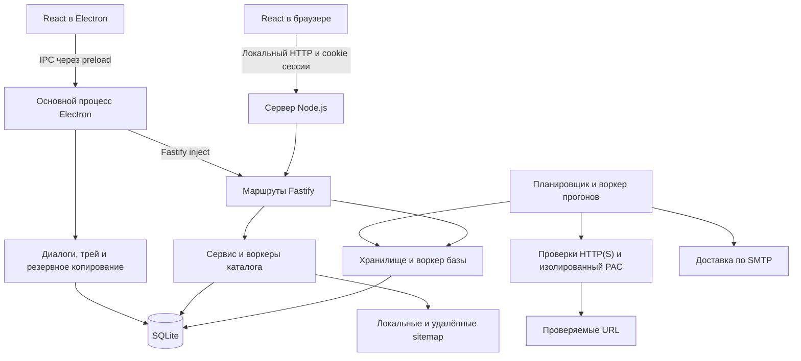

# Архитектура и контракты Пульса URL

[English](architecture.md) · [Руководство разработчика](README.ru.md)

Пульс URL — локальное однопользовательское приложение. React использует один API-клиент в браузере и Electron. В браузере запросы идут по локальному HTTP. В Electron интерфейс открывается по `pulse-app://app/`, а разрешённые запросы проходят через preload и `inject()` Fastify в основном процессе.

Точка входа каждого режима открывает профиль, получает право владения базой и запускает сервисы каталога и расписания. Веб-сервер слушает loopback и завершает работу по SIGINT или SIGTERM. Electron управляет окном, треем, ссылками на отчёты и доступом к файлам. При закрытии окна фоновые задачи продолжаются. Действие **Выход** завершает работу и закрывает базу. [Веб-сервер](../../src/server/main.ts) · [Точка входа Electron](../../src/desktop/main.ts)

React хранит состояние в хуках, а навигацию и применённые фильтры — в URL. Интерфейс обновляет прогресс опросом. Сводка проекта принимает последнюю `revision` в параметре `since` и может ответить `{ unchanged: true }`. API проверяет входные данные. Долгие операции SQLite выполняются в воркере, а потоковый экспорт читает снимок, чтобы правки проекта не меняли выгрузку в процессе записи. [API-клиент](../../src/client/api.ts) · [Fastify](../../src/server/app.ts) · [Задачи базы](../../src/server/database-tasks.ts)

Воркер берёт прогоны из очереди, использует сохранённую политику HTTP-запросов и записывает результаты и счётчики. Ошибки отдельной проверки становятся частью результата URL. По завершении прогона приложение может создать уведомление и письмо. При обычном перезапуске прерванные проверки возвращаются в очередь, а отправлявшиеся письма получают статус неподтверждённой доставки. [Воркер прогонов](../../src/server/worker.ts) · [Хранилище](../../src/server/store.ts)

## Языковые настройки

Оба режима включают словари `ru-RU` и `en-US`. Интерфейс меняет подписи и форматирование через общую подписку на язык. Web хранит `urlpulse.locale` в браузере и синхронизирует вкладки одного источника. Electron сохраняет язык в профиле и обновляет меню, трей и подписи диалогов приложения.

В SQLite хранятся исходные диагностики и машинные значения. Известные сообщения, в том числе из истории, переводятся при отображении. Язык отчёта Excel фиксируется при начале выгрузки. Язык письма общий для установки и выбирается через `PULSE_EMAIL_LOCALE` в web или `emailLocale` в Electron независимо от текущего языка окна. [Руководство по переводу](../localization/TRANSLATION_GUIDE.md) · [Каталоги](../../src/shared/i18n/)

## Структура репозитория

| Путь | Назначение |
| --- | --- |
| `src/client/` | Экраны React, навигация, API-клиент и стили |
| `src/server/` | Fastify, SQLite, проверки, расписание и воркеры |
| `src/server/catalog/` | Импорт sitemap, каталог, выгрузки и перенос |
| `src/desktop/` | Основной процесс и preload Electron, настройки, секреты и копии |
| `src/shared/` | Общие типы, контракты и локализация |
| `tests/`, `e2e/` | Vitest, Playwright, временные фикстуры и smoke |
| `scripts/`, `packaging/` | Покрытие, замеры, упаковка DMG и NSIS |
| `.github/workflows/`, `docs/` | CI, выпуск и документация |

## Модель данных SQLite

- Активные URL уникальны в проекте. Изменение адреса создаёт версию, а удаление из списка архивирует адрес. Результат хранит проверенную версию, URL и название. Предыдущая проверка для отчёта берётся по времени из завершённого прогона той же версии URL.
- Прогоны имеют состояния `queued`, `running`, `done`, `cancelled`. Для каждого URL в прогоне хранится один результат. Остановка сохраняет частичный отчёт и исходные цели для перезапуска, когда они доступны. При постановке в очередь фиксируются профиль HTTPS, политика запросов и ревизия PAC. Ревизия включает файл и настройки прокси со ссылками на секреты. Импорт каталога сохраняет эту ревизию в `catalog_imports.pac_revision` для продолжения после паузы или перезапуска.
- Транспорт PAC находит доверенную запись по схеме, имени и порту. Сокет прокси использует проверенный DNS-адрес. Доверенная запись может разрешить RFC 1918 или IPv6 ULA для прокси и передать ему выбор адреса цели. Basic применяется только к совпавшему HTTPS-прокси. Поток каталога запрашивает пароль по ссылке из снимка через основной процесс. Секрет Electron освобождается после удаления последней настройки или задачи, которую ещё можно выполнить.
- Источники sitemap ведут текущий и предыдущий снимки с документами, адресами и изменениями. Перенос ссылается на конкретные снимки и добавляет URL в рабочий список порциями. Каталог также создаёт разовые проверки выбранных адресов.
- SQLite использует WAL и внешние ключи. Файл `.owner-lock` защищает базу от одновременного открытия несколькими экземплярами. В web секреты HTTP-профилей поступают из окружения. Electron хранит секреты и SMTP-данные вне базы с шифрованием средствами ОС.

[Диаграмма связей](architecture.md#sqlite-data-model) · [Основная схема](../../src/server/schema.ts) · [Схема каталога](../../src/server/catalog/schema.ts)

При восстановлении Electron проверяет схему, внешние ключи, счётчики и цели прогонов и применяет миграции к временной копии. Уже полученные результаты сохраняются. Недоставленные письма и незавершённые задания каталога из копии очищаются. После подтверждения Electron завершает операции базы, сохраняет предыдущую копию, ставит расписания на паузу, заменяет базу и перезапускается. Журнал временных файлов позволяет убрать остатки прерванных операций при старте. Для переноса настройте SMTP и HTTP-секреты на новом компьютере. Для ручной копии веб-базы сначала остановите процесс. [Владение базой](../../src/server/database-owner.ts) · [Резервное копирование](../../src/desktop/backup.ts) · [Журнал временных файлов](../../src/desktop/staging.ts)

## Локальный HTTP API

Это внутренние контракты интерфейса. Web слушает `127.0.0.1:8731`. Клиент извлекает ключ из ссылки `/#access=…`, удаляет его из адресной строки и отправляет `POST /api/session` с `{ "key": "…" }`. Успех — `204` и cookie `pulse_web_session` для `/api` с `HttpOnly`, `SameSite=Strict` и `Secure`. API проверяет сессию, а изменяющие запросы — локальный источник. [Сессии](../../src/server/web-access.ts) · [Маршруты](../../src/server/app.ts)

| Метод и путь | Контракт |
| --- | --- |
| `GET /api/projects` | Возвращает `{ projects, unread, smtpConfigured }` и `schedulesPaused`, если доступно. |
| `POST /api/projects` | Принимает `{ name, description? }`. Название до 70 символов, описание до 200. Возвращает проект и `201`. |
| `GET /api/projects/:projectId?view=summary` | Сводка проекта и ревизия. Для условного опроса передайте `since`. |
| `GET /api/projects/:projectId/urls/page` | Параметры `page`, `q`, `status`, `sort`, `direction`, `group`. Возвращает `{ items, total, page }`. |
| `POST /api/projects/:projectId/urls` | Поля `{ input, label? }`. До 1 000 непустых строк, `label` для одиночного URL. Возвращает `201` и `{ added, duplicates, invalid, skipped, issues }`. |
| `GET /api/projects/:projectId/urls/:urlId` | `{ address, versions, history }`. Для старых результатов — `before` и при наличии `beforeAt`. |
| `POST /api/projects/:projectId/runs` | `{}` для рабочего списка или `{ ids: [...] }` с выборкой до 5 000 адресов. Возвращает `202` с `{ id }`. |
| `GET /api/projects/:projectId/runs?view=page` | Журнал с `{ items, nextBefore }`. Передайте `before` для следующей страницы. `view=queue` возвращает очередь. |
| `GET /api/projects/:projectId/runs/:runId` | Отчёт `{ run, results, previousRun, nextAfter, restart }`. Поддерживает `after`, `q`, `status`, `httpCode`, `change`. |
| `POST …/runs/:runId/stop`, `POST …/runs/:runId/restart` | Остановка возвращает итоговое состояние. Повтор создаёт новый прогон и возвращает `202` с `{ id }`. |
| `GET …/run-comparison` | Передайте разные ID `baseline` и `target` этого проекта со статусом `done` или `cancelled` и результатами. `view=summary` возвращает счётчики. Без `view` — `{ items, nextAfter }`. Доступны `q`, `kind`, `after`. |
| `GET …/export`, `GET …/runs/:runId/export`, `GET …/urls/:urlId/export`, `GET …/groups/:groupId/export`, `GET …/run-comparison/export` | Потоковый экспорт с `format=csv`, `excel` или `json` и применимыми фильтрами. Сравнение требует ID пары. `locale=en-US` выбирает английский Excel, по умолчанию используется `ru-RU`. CSV и JSON сохраняют машинные поля. |
| `GET …/catalog`, `GET …/catalog/page`, `POST …/catalog/imports` | Сводка источников, страницы адресов или постановка импорта в очередь. Файл передаётся через `PUT …/catalog/imports/:jobId/file` с типом `application/octet-stream`. |
| `GET …/request-profiles` | `{ profiles, secretMode }`. Используйте `GET` и `PATCH …/urls/:urlId/request-profile` для переопределения URL. В `{ profileId }` передайте `'inherit'`, `null` для прямого маршрута или ID профиля. |
| `GET`, `PUT`, `PATCH`, `DELETE …/proxy-pac`, `POST …/proxy-pac/test` | Чтение, установка, обновление списка прокси, отключение и проба PAC. `PUT` принимает `{ filename, source }` до 256 КиБ. `PATCH` принимает `{ revision, proxies }` с полями `url`, `allowPrivate`, `connectByHostname` и необязательным `auth: { username, secret? }` в правилах. Устаревшая ревизия возвращает 409. Пустое поле пароля сохраняет его для того же адреса и логина. Ответ `{ pac }` содержит метаданные и статус настройки или `null`. Проба принимает `{ url }` и возвращает `{ routes, source }`. |

Сокращение `…` обозначает префикс `/api/projects/:projectId`. Ответы об ошибках содержат `{ error: string }`. Запросы с заголовком `x-urlpulse-i18n: 1` сохраняют исходный текст ошибки, а для известных сообщений могут дополнительно получить `messageKey` и проверенные `messageParams`. При прямом скачивании Excel с `locale=en-US` известные ошибки выводятся на английском. Типичные коды API — `400`, `401`, `403`, `404`, `409`, `413`, `503`. Сбой проверки URL хранится в результате с `status: "error"`. [Пример чтения отчёта из браузера](architecture.md#loopback-http-api)

## Electron IPC

Preload предоставляет `window.pulseDesktop` с контрактом `DesktopBridge`. Основной процесс проверяет канал, отправителя, кадр и аргументы. В `pulse:request` передаются `{ path, method, body?, i18n? }` с разрешёнными методом и путём и JSON в виде строки. `i18n: true` включает структурированные диагностики. Ответ — `{ status, data }`. При завершении приложение возвращает `503` с `code: "desktop-shutdown"`, чтобы интерфейс прекратил опрос. [Типы](../../src/shared/desktop.ts) · [Preload](../../src/desktop/preload.cts) · [Проверка запроса](../../src/desktop/contracts.ts)

| Каналы | Аргументы и результат |
| --- | --- |
| `pulse:open-address` | ID проекта и URL. Открывает сохранённый HTTP(S)-адрес в браузере. |
| `pulse:export-report`, `pulse:export-comparison`, `pulse:export-catalog` | Экспорт отчёта принимает путь ресурса без `/export`, формат, необязательные фильтры и локаль. Экспорт сравнения принимает проект, пару с фильтрами, формат и необязательную локаль. Каталог принимает проект, фильтр и выборку. Результат — `{ saved: true }` или `{ saved: false, error? }`. |
| `pulse:pick-catalog` | ID проекта и необязательный ID источника. Возвращает `{ sourceId }` или `null` при отмене выбора. |
| `pulse:export-backup`, `pulse:import-backup`, `pulse:backup-progress` | Экспорт возвращает результат сохранения. Импорт возвращает boolean, сообщает стадии `copy`, `validate`, `prepare`, `replace` и `null` после завершения. При успехе приложение перезапускается. |
| `pulse:get-preferences`, `pulse:save-preferences` | Чтение и запись разделов `background`, `smtp` и `email-language`. Состояние SMTP содержит `hasPassword`. Сохранение может вернуть `loginError`. |
| `pulse:get-locale`, `pulse:set-locale`, `pulse:locale-changed` | Чтение и запись языка интерфейса. Допустимы `ru-RU` и `en-US`. При изменении основной процесс уведомляет renderer. |
| `pulse:navigation-ready`, `pulse:navigate` | Сигнал готовности интерфейса и событие навигации при ссылках `pulse-url://report/?project=1&run=2`. Событие передаёт относительный путь интерфейса. |

Приложение выполняет нативные файловые операции по одной. Отмена диалога записи возвращает `{ saved: false }`. Ошибка файловой системы может дополнить ответ текстом `error`. [Обработчики IPC](../../src/desktop/main.ts)
